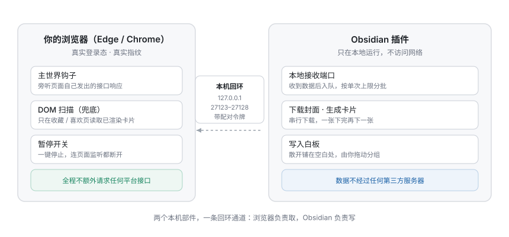
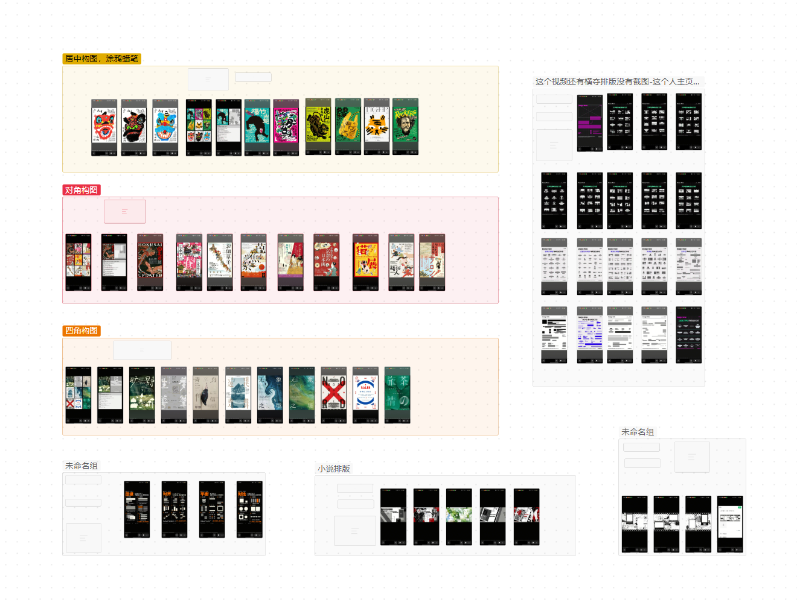
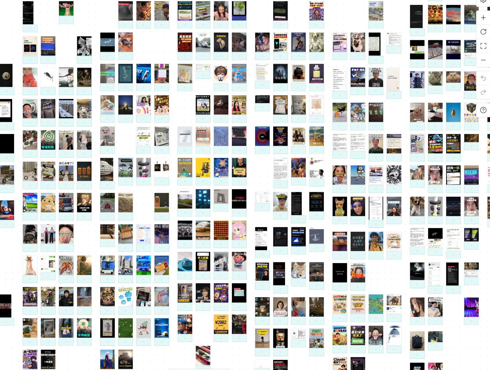
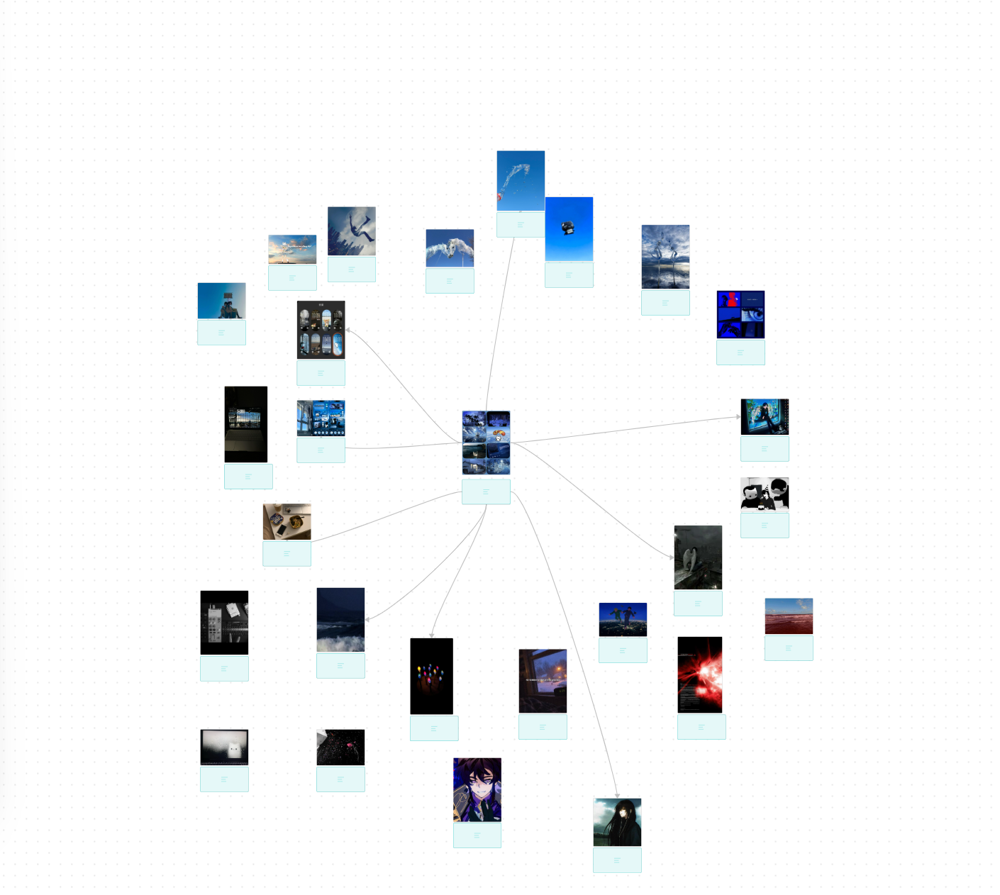
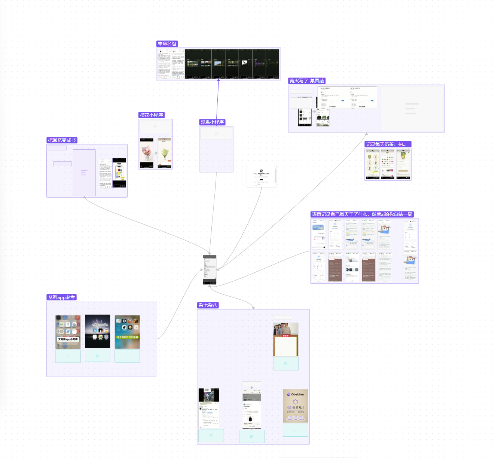

# Social Favboard · 收藏夹画板

**简体中文** | [English](README_EN.md)

把社交媒体里的**喜欢与收藏**——抖音「喜欢 / 收藏」、B站收藏夹、小红书「收藏 / 赞过」——整理成 Obsidian Canvas 白板上的卡片，带封面、标题、作者和原链接。

卡片散开铺在空白处，**由你自己拖动分类、上色、连线**。工具不替你做归类，只负责把素材搬到画板上。

<p align="center">
  
</p>

## 实际效果

**按关键词自动分类**——卡片直接落进对应分组框，框不够高会自己变高：

<p align="center">
  
</p>

**刷出来的量**——几百张卡片铺满白板，互相之间零重叠：

<p align="center">
  
</p>

**手动模式也不乱**——散卡围绕主题连线，拖动、连接全凭你：

<p align="center">
  
</p>

**同一块板还能当灵感 moodboard 用**——截图、文章、App 参考混排：

<p align="center">
  
</p>

---

## 它解决什么

刷短视频时顺手收藏了一堆，事后想整理成灵感库，但一条条复制链接、截图、贴进 Obsidian 太费手。

这个工具只做一件事：**你在浏览器里正常往下滚，白板上的卡片自己长出来。**

## 它不做什么

- ❌ 不联网、不上传、不需要注册账号
- ❌ 不调用平台私有接口，不伪造登录态，不破解签名
- ❌ 不自动翻页，不批量拉取你没看过的内容
- ❌ 不替你分类——分类是你的判断，工具不做

---

## 工作原理

两个部件，各管一段，中间用本机端口通信：

| 部件 | 跑在哪 | 职责 |
|---|---|---|
| `browser-extension/` | 你的浏览器（Edge / Chrome） | 读页面**已经加载出来**的内容，发给插件 |
| `social-favboard/` | Obsidian 内部 | 收数据、下载封面、生成卡片、写进白板 |

**为什么必须两个：**

- 浏览器扩展没有写本地文件的权限（浏览器安全模型限制）
- Obsidian 插件没有你的平台登录态，硬去请求就得伪造身份

所以只能「浏览器里取，Obsidian 里写」，中间走 `127.0.0.1` 回环端口，数据不出本机。

### 数据从哪来

两条线并行，任一条断了另一条还在：

1. **主世界钩子**（优先）：页面自己发请求拿列表，扩展在旁边把响应抄下来。签名、cookie、指纹全是页面自己的，扩展不额外发任何请求。
2. **DOM 扫描**（兜底）：直接在页面上找卡片元素，读标题和封面。

---

## 安装

### 前置要求

- Obsidian **桌面版**（1.4.0+）。移动端不支持，插件用了 Node 的 `http` 模块起本地端口。
- Edge / Chrome / Brave / Vivaldi 等 Chromium 内核浏览器（111+）

### 第一步：安装 Obsidian 插件

1. 下载本仓库（右上角 `Code` → `Download ZIP`，或 `git clone`）
2. 打开你的 vault 目录。Windows 下 `.obsidian` 是**隐藏文件夹**，建议在地址栏直接输路径
3. 把仓库里的 `social-favboard` 整个文件夹，复制到：

   ```
   <你的 vault>/.obsidian/plugins/social-favboard
   ```

   最终结构应该是 `.obsidian/plugins/social-favboard/main.js` 这样，**不要多套一层文件夹**。

4. 重开 Obsidian → 设置 → **第三方插件** → 关闭「安全模式」
5. 在「已安装插件」里找到 **Social Favboard**，打开开关
6. 左侧栏会出现一个胶片图标 🎞

### 第二步：安装浏览器扩展

1. 把仓库里的 `browser-extension` 文件夹**复制到一个固定位置**（比如 `D:\Tools\social-favboard-extension`）。**别放在下载目录**，清空下载文件夹扩展就失效了。
2. 浏览器地址栏输入：
   - Edge：`edge://extensions`
   - Chrome：`chrome://extensions`
3. 打开「**开发者模式**」
4. 点「**加载解压缩的扩展**」→ 选中 `browser-extension` 文件夹（**选文件夹本身，不是里面的文件**）
5. 点工具栏的拼图图标 🧩，把 **Social Favboard** 固定出来

> **找不到「开发者模式」开关？**
> Edge 新版把这个开关挪走了，位置不固定。最可靠的打开方式：
> 在 `edge://extensions` 页面按 **F12** → 切到「**控制台**」→ 粘贴这行回车：
>
> ```js
> chrome.developerPrivate.updateProfileConfiguration({inDeveloperMode: true})
> ```
>
> 如果提示「请勿粘贴」，先输入 `允许粘贴` 回车，再粘代码。回车后页面会刷新，多出「加载解压缩的扩展」按钮。

> **Firefox 用户**：Firefox 不允许永久安装未签名扩展，只能用 `about:debugging#/runtime/this-firefox` → 「临时载入附加组件」选 `manifest.json`（关掉浏览器后失效）。完整步骤、以及怎么签名成 `.xpi` 给普通用户永久安装，见 [安装教程.md](安装教程.md) 的「Firefox 用户怎么装」。

### 第三步：配置

在 Obsidian 设置 → 第三方插件 → Social Favboard：

| 设置项 | 说明 |
|---|---|
| **默认写入白板** | 填**相对于 vault 的路径**，如 `卡片/我的收藏.canvas`。**不要填 `C:\...` 这种绝对路径**，也不要带 vault 名 |
| 封面目录 | 默认 `video-covers`，可以改 |
| 单次同步上限 | 默认 30。超出的留在队列，下次继续 |
| 主题 | 自己建，每个主题一个名字 + 一种颜色 |

**这个 `.canvas` 文件必须已经存在**，插件不会帮你创建。

---

## 使用

1. 浏览器打开收藏页：

   | 平台 | 打开哪里 | 地址特征 |
   |---|---|---|
   | 抖音 | 点头像 → **喜欢 / 收藏** | `/user/...` |
   | B站 | 某个**收藏夹** | 含 `favlist` |
   | 小红书 | 个人页 → **收藏** 或 **赞过** | `/user/profile/...` |

2. **正常往下滚**，什么都不用点
3. 滚一会儿回 Obsidian 看白板

首屏也会抓，不用先滑一下。页面打开后等 1~2 秒，让首次扫描跑完。

**首页、播放页、搜索页不会收集**——那里的视频不是你的收藏。

## 卡片长什么样

每张卡片是「封面图 + 一段文字节点」，文字大致是这样：

```
**视频标题**

作者 · 抖音 · 03:21
收录 2026-10-31
#美食

[▶ 打开原视频](链接)
```

- **收录 日期**：抓到这条的当天日期，精确到日（旧卡片没有这个字段，不会显示）；
- **#分类名**：只在「按关键词自动分类」模式下出现；
- 小红书卡片会多一行搜索链接兜底，没有 token 时只给搜索链接。

## 分类：手动 or 关键词

插件设置里有个「分类方式」，二选一，随时可切。

**手动（默认）**
卡片散铺在白板右侧，你想怎么拖就怎么拖，主题、颜色、位置全由你定。开关切到手动时，插件不会动你已经摆好的任何东西。

**按关键词自动分类**
给每个分类起个名字、填几个关键词（逗号分隔），再挑一个分组颜色。之后写进来的卡片会：

1. 拿标题去匹配关键词，**按规则从上到下**，先命中的算；
2. 标题都没命中，再拿标题 + 作者匹配一遍；
3. 都没命中 → 进「其他」框；
4. 卡片被放进对应分组框的空位里，框会自己变高，不会压住已有卡片。

> 关键词示例：分类「美食」填 `探店, 菜谱, 好吃, 下饭`；分类「旅行」填 `vlog, 攻略, 川西`。

已经在白板上的卡片不会因为你切换模式而乱跑。想一次性整理存量，点设置里的 **「立即整理当前白板」**（或命令面板搜「按关键词整理当前白板」）。

整理的行为边界：

- 只搬动本项目生成的卡片（正文带「打开原视频」链接的那些），**你自己画的卡片、手写文字一律不动**；
- 分组框的位置是「整块找空地」算出来的，逐个矩形比对已有内容，**不会盖住任何卡片，框和框之间也不会重叠**；
- 重复点整理不会叠加出重复的框，同名旧框会被先拆掉再重排。

> 白板原生只有 6 种颜色，分类超过 6 个时颜色会重复，靠框上的名字区分。

## 暂停抓取

点扩展图标，最上面那个绿色大按钮就是总开关。

暂停后：

- 变红，显示「恢复收集」
- 工具栏图标出现灰色 `OFF` 角标
- **对所有标签页立即生效**，连页面监听都断开
- 已抓到手的会先送出去再停
- 关浏览器、重开页面都保持暂停状态

---

## 常见问题

**小红书卡片点开显示「当前笔记暂时无法浏览」**
小红书现在要求笔记链接带 `xsec_token`（页面自己发的临时令牌），不带就跳 404。扩展会从页面**已经返回的接口响应**里抓这个 token，不额外发请求。

- 抓到了 → 卡片上是 `[▶ 打开原帖]`，能直接进；
- 抓不到 → **不会给你一条必然 404 的死链**，直接换成 `[🔍 在小红书搜索这条]`，点开在搜索结果里能找回来。

另外两点要提前知道：**token 是临时的**，几天后会过期，所以带 token 的卡片后面始终多一行搜索链接兜底；2025 年之前收的旧卡没有 token，离线补不出来，只能重新收一遍。

**工具栏图标上的数字是什么**
橙色数字 = 还有这么多条没送进 Obsidian（一般是 Obsidian 没开或插件没启用，开了会自动补发）。灰色 `OFF` = 已暂停收集。什么都不显示 = 一切正常。

**滚了半天白板没反应**
先看图标上的数字：有数字说明抓到了、没送出去；没数字说明这页不在采集范围 —— 只认抖音「喜欢 / 收藏」、B站收藏夹、小红书「收藏 / 赞过」这几个**列表页**，笔记详情页、首页、搜索页都不采。

**扩展显示「未连接」**
Obsidian 没开，或插件没启用。数据会先暂存在浏览器本地（最多 5000 条），Obsidian 开了自动补发。

**白板里没东西，但队列里有数据**
九成是「默认写入白板」路径填错。要相对路径，不要绝对路径。

**抓到的卡片标题是 `icon`、封面是同一个头像**
扩展跑的是旧代码。到 `edge://extensions` 点刷新箭头，**并且把所有旧标签页关掉重开**。

**白板卡片位置很乱**
设计如此。卡片按网格铺在已有内容的右侧，间距留给手动拖动。

**B站有多个收藏夹**
只能扫当前打开的那个，需要逐个点开。

---

## 限制

**只有你滑到的才抓得到。** 平台一屏只加载一批，不滚就不请求。这是平台设定，任何工具都突破不了。

**平台改版会失效。** 抖音和小红书的页面结构变化较频繁，扩展可能需要跟着更新。B站有稳定公开接口，相对耐改。

**桌面端限定。** 插件依赖 Node 的 `http` 模块起本地端口，Obsidian 移动端跑不了。

**主题颜色只有 6 种。** Obsidian Canvas 原生只支持红橙黄绿青紫，主题超过 6 个颜色必然重复，所以每张卡片会印一行 `#主题名` 兜底。

---

## 想支持更多平台？欢迎 PR

> **Want more platforms (YouTube, Twitter/X, Instagram…)? Pull requests are welcome!**

本项目目前只支持抖音、B站、小红书。想加油管、推特这类平台的朋友，欢迎直接提交 PR，你不用经过我，仓库自己 Fork 一份改完发过来就行。

新平台的接入点很集中，都在 `browser-extension/content.js`：

1. 平台识别：`PLAT` 判定（按域名认平台）；
2. 页面白名单：只放行该平台的**收藏/喜欢列表页**；
3. 接口响应解析（主路）+ DOM 扫描选择器（兜底）；
4. 链接生成规则（该平台的原帖链接格式）。

Obsidian 插件那边基本不用动——它不关心内容来自哪个平台。

**三条铁律对任何新平台同样适用**：只旁听页面自己的请求、不额外发请求、不碰登录态。违反这三条的 PR 会被直接拒绝。提交前请跑通 `npm test`，并参考 [CONTRIBUTING.md](CONTRIBUTING.md)。

---

## 关于合规与风险

必须说清楚，不粉饰：

**这类工具都违反平台服务条款。** 无论读 DOM 还是读响应，都落在「未经许可的自动化获取内容」这一条里。

**但不触碰法律红线。** 抓的是你自己的收藏、个人使用、不商业化、不破解任何加密。

**架构上刻意把风险压到最低：**

| 高危做法 | 本项目 |
|---|---|
| 逆向签名后自己调接口 | 没有 |
| 循环翻页批量拉取 | 没有 |
| 模拟器 / 多账号 / 共用指纹 | 没有 |
| 自动过验证码 | 没有 |
| 高频请求刷接口 | 没有，封面串行下载、间隔 70ms |

请求全部由你真实浏览器发出，扩展不额外发任何面向平台的请求。**但「零风险」只有纯手动才有，这一点不骗人。**

用不用、用到什么规模，自己判断。

---

## 目录结构

```
.
├── social-favboard/       # Obsidian 插件（复制到 .obsidian/plugins/social-favboard）
│   ├── manifest.json
│   ├── main.js
│   └── styles.css
├── browser-extension/     # 浏览器扩展（MV3）
│   ├── manifest.json
│   ├── inject.js          # 主世界钩子，document_start 注入
│   ├── content.js         # 数据收集、DOM 扫描、暂停开关
│   ├── background.js      # 暂存、转发到本机端口
│   ├── popup.html
│   └── popup.js
├── test/
│   └── e2e.test.js        # 100 项自动化测试
├── docs/
│   └── architecture.svg
├── LICENSE
└── package.json
```

## 开发

无构建步骤，无第三方依赖，改完保存即生效。

```bash
npm test        # 跑 100 项测试（用 Node 内置 vm 模拟浏览器与 Obsidian 环境）
```

测试覆盖：端口通信、令牌校验、CORS 预检、三平台响应解析、Canvas 节点格式与布局、路径清洗、垃圾数据过滤、分批上限、暂停开关。

**改完代码后：**

- 插件 → 复制 `main.js` 到 vault 的插件目录，Obsidian 里关掉再打开
- 扩展 → `edge://extensions` 点刷新箭头，**并关掉旧标签页**

## License

[MIT](LICENSE)
