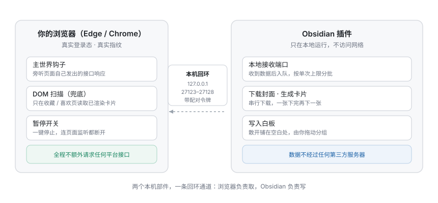
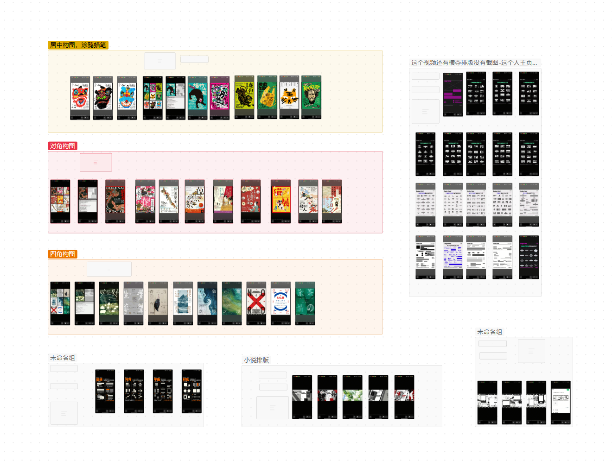
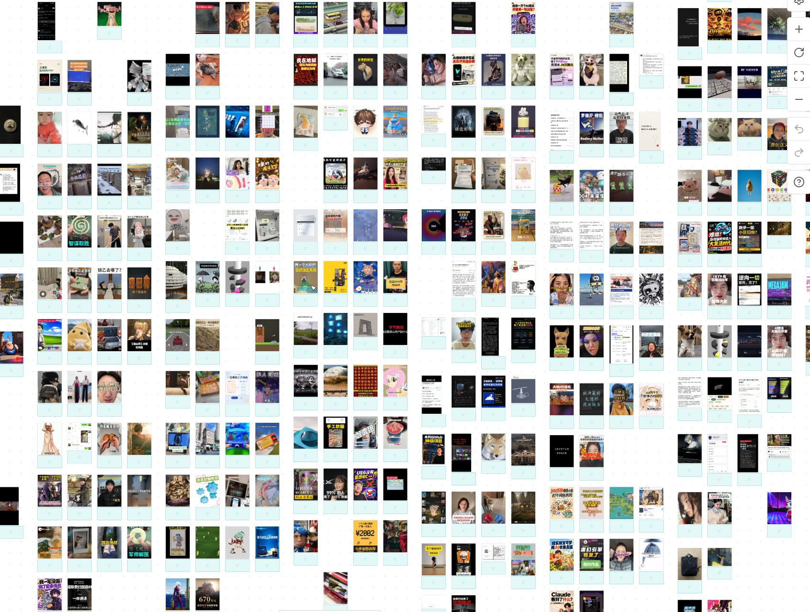
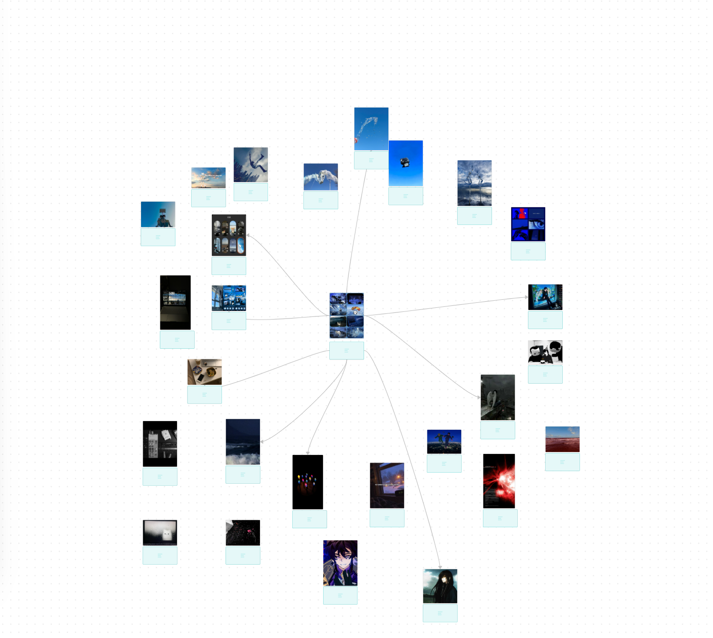
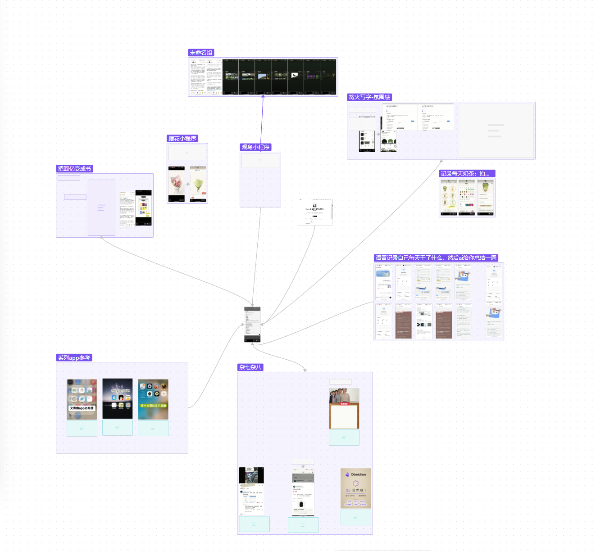

# Social Favboard · Favorites Board

[简体中文](README.md) | **English**

Turn your **likes and favorites** on social media — Douyin (likes / collections), Bilibili favorites folders, Xiaohongshu (collected / liked) — into cards on an Obsidian Canvas board, each with cover image, title, author and the original link.

Cards are spread across empty space, and **you do the sorting yourself**: drag them into groups, color them, connect them. The tool doesn't organize for you — it just moves the material onto the canvas.

<p align="center">
  
</p>

## Real-world results

**Keyword auto-classification** — cards land straight into their group frames, which grow taller as needed:

<p align="center">
  
</p>

**Volume** — hundreds of cards filling the board with zero overlaps:

<p align="center">
  
</p>

**Manual mode stays tidy too** — loose cards connected around a topic; dragging and linking are all yours:

<p align="center">
  
</p>

**The same board doubles as an inspiration moodboard** — screenshots, articles and app references mixed together:

<p align="center">
  
</p>

---

## What problem it solves

You collect a pile of short videos while scrolling, then want to turn them into an inspiration library — but copying links one by one, taking screenshots and pasting them into Obsidian is tedious.

This tool does exactly one thing: **you scroll normally in your browser, and the cards grow onto the board by themselves.**

## What it does NOT do

- ❌ No cloud, no upload, no account needed
- ❌ No private platform APIs, no fake login states, no signature cracking
- ❌ No auto-pagination, no bulk pulling of content you haven't viewed
- ❌ No auto-classification — sorting is your judgment call, not the tool's

---

## How it works

Two components, each handling one half, talking over a local port:

| Component | Runs in | Job |
|---|---|---|
| `browser-extension/` | Your browser (Edge / Chrome) | Reads content **already loaded on the page**, sends it to the plugin |
| `social-favboard/` | Inside Obsidian | Receives data, downloads covers, builds cards, writes to the board |

**Why two components:**

- Browser extensions have no permission to write local files (browser security model)
- The Obsidian plugin has no login state for the platforms; requesting on its own would mean faking identities

So the only clean split is "grab in the browser, write in Obsidian", with `127.0.0.1` loopback in between. Data never leaves your machine.

### Where the data comes from

Two parallel sources, so if one breaks the other still works:

1. **Main-world hook** (primary): the page itself requests its own lists; the extension copies the responses as they arrive. Signatures, cookies and fingerprints all belong to the page itself — the extension sends no extra requests.
2. **DOM scanning** (fallback): finds card elements on the page directly and reads titles and covers.

---

## Installation

### Prerequisites

- Obsidian **desktop** (1.4.0+). Mobile is not supported — the plugin uses Node's `http` module to open a local port.
- A Chromium-based browser (111+): Edge / Chrome / Brave / Vivaldi, etc.

### Step 1: Install the Obsidian plugin

1. Download this repo (top-right `Code` → `Download ZIP`, or `git clone`)
2. Open your vault folder. On Windows `.obsidian` is a **hidden folder** — typing the path into the address bar works best
3. Copy the whole `social-favboard` folder from the repo into:

   ```
   <your vault>/.obsidian/plugins/social-favboard
   ```

   The final structure should be `.obsidian/plugins/social-favboard/main.js` — **don't nest an extra folder level**.

4. Restart Obsidian → Settings → **Community plugins** → turn off Restricted mode
5. Find **Social Favboard** under Installed plugins and toggle it on
6. A film-strip icon 🎞 appears in the left sidebar

### Step 2: Install the browser extension

1. Copy the `browser-extension` folder to **a permanent location** (e.g. `D:\Tools\social-favboard-extension`). **Don't leave it in Downloads** — clearing the downloads folder breaks the extension.
2. In the browser address bar, enter:
   - Edge: `edge://extensions`
   - Chrome: `chrome://extensions`
3. Turn on **Developer mode**
4. Click **Load unpacked** → select the `browser-extension` folder (**the folder itself, not the files inside**)
5. Click the puzzle-piece icon 🧩 in the toolbar and pin **Social Favboard**

> **Can't find the Developer mode toggle?**
> Recent Edge versions moved it around. The most reliable way:
> On the `edge://extensions` page press **F12** → open the **Console** → paste this and hit Enter:
>
> ```js
> chrome.developerPrivate.updateProfileConfiguration({inDeveloperMode: true})
> ```
>
> If it warns "do not paste", type `allow pasting` first, then paste the code. The page refreshes and the "Load unpacked" button appears.

> **Firefox users**: Firefox doesn't allow permanently installing unsigned extensions — use `about:debugging#/runtime/this-firefox` → "Load Temporary Add-on" and pick `manifest.json` (it disappears when the browser closes). For full steps and how to sign an `.xpi` for permanent install, see the Firefox section in [docs/INSTALL_EN.md](docs/INSTALL_EN.md).

### Step 3: Configure

In Obsidian: Settings → Community plugins → Social Favboard:

| Setting | Notes |
|---|---|
| **Target canvas** | A path **relative to the vault**, e.g. `cards/my-favorites.canvas`. **Never an absolute `C:\...` path**, and don't include the vault name |
| Cover folder | Defaults to `video-covers`, changeable |
| Per-batch limit | Defaults to 30. Extras stay in the queue for next round |
| Topics | Create your own: one name + one color each |

**The `.canvas` file must already exist** — the plugin won't create it for you.

---

## Usage

1. Open a favorites page in the browser:

   | Platform | Where | URL pattern |
   |---|---|---|
   | Douyin | Avatar → **Likes / Collections** | `/user/...` |
   | Bilibili | A **favorites folder** | contains `favlist` |
   | Xiaohongshu | Profile → **Collected** or **Liked** | `/user/profile/...` |

2. **Scroll down normally** — click nothing
3. After a bit, check the board in Obsidian

The first screen is captured too, no need to jiggle the page first. Give it 1–2 seconds after the page opens for the initial scan.

**Home pages, video pages and search pages are not collected** — those videos aren't your favorites.

## What a card looks like

Each card is "cover image + one text node". The text looks roughly like:

```
**Video title**

Author · Douyin · 03:21
Saved 2026-10-31
#food

[▶ Open original](link)
```

- **Saved date**: the day the item was captured (older cards lack this field, so the line is omitted);
- **#topic**: only appears in keyword auto-classification mode;
- Xiaohongshu cards carry an extra search link as fallback — when no token is available, only the search link is given.

## Classification: manual or keyword

The plugin settings have a "Classification mode" — pick one, switch anytime.

**Manual (default)**
Cards are spread on the right side of the board; drag them however you like. Topic, color and position are all yours. In manual mode the plugin never touches anything you've already placed.

**Keyword auto-classification**
Give each category a name, a few keywords (comma-separated) and a group color. New cards then:

1. Match keywords against the title, **rules applied top to bottom**, first hit wins;
2. If no title hit, match again with title + author;
3. No hit at all → goes into the "Other" group;
4. The card is placed into a free slot inside its group frame — the frame grows taller as needed and never covers existing cards.

> Keyword examples: category "Food" with `restaurant, recipe, tasty`; category "Travel" with `vlog, guide`.

Cards already on the board don't jump around when you switch modes. To re-organize the backlog in one go, use **"Organize current canvas now"** in settings (or search the command palette).

Boundaries of the organize action:

- Only moves cards created by this project (the ones with an "Open original" link in the body) — **your own cards and handwritten notes are never touched**;
- Group frame positions are computed by "find a whole empty rectangle": each candidate block is tested against every existing node, so **no card is ever covered, and frames never overlap each other**;
- Running organize repeatedly won't stack duplicate frames — old same-name frames are dismantled before rebuilding.

> Obsidian Canvas natively offers only 6 colors; with more than 6 topics colors repeat and the frame name is what tells them apart.

## Pausing collection

Click the extension icon — the big green button at the top is the master switch.

While paused:

- It turns red and reads "Resume"
- A gray `OFF` badge appears on the toolbar icon
- **Applies to all tabs immediately** — even the page listeners disconnect
- Anything already captured is sent out first, then collection stops
- Pause survives browser restarts and page reloads

---

## FAQ

**Xiaohongshu card shows "This note cannot be viewed"**
Xiaohongshu now requires note links to carry `xsec_token` (a temporary token the page itself requests); without it you get a 404. The extension grabs this token from API responses **the page has already received** — no extra requests.

- Token captured → the card gets `[▶ Open original]` and opens directly;
- No token → **you never get a guaranteed-404 dead link**. Instead it becomes `[🔍 Search this on Xiaohongshu]`, which finds the note via search results.

Two more things to know: **tokens expire** after a few days, so tokened cards always carry a search-link fallback line; old cards saved before 2025 have no token and can't be repaired offline — just re-collect them.

**What's the number on the toolbar icon**
Orange number = that many items haven't been delivered to Obsidian yet (usually Obsidian is closed or the plugin disabled; it auto-retries once opened). Gray `OFF` = collection paused. Nothing shown = all normal.

**Scrolled a lot but the board stays empty**
Check the icon number first: a number means items were captured but not delivered; no number means the page isn't in the collection whitelist — only Douyin **Likes / Collections**, Bilibili **favorites folders** and Xiaohongshu **Collected / Liked** **list pages** are collected; note detail pages, home pages and search pages are not.

**Extension shows "Not connected"**
Obsidian is closed or the plugin is disabled. Data stays buffered in the browser (up to 5000 items) and auto-delivers when Obsidian opens.

**Nothing on the board, but the queue has data**
Almost certainly the "Target canvas" path is wrong. Use a relative path, not absolute.

**Captured titles are `icon` and every cover is the same avatar**
The extension is running old code. Hit the refresh arrow on `edge://extensions`, **and close and reopen all old tabs**.

**Card positions look messy**
By design. Cards are laid out on a grid to the right of existing content, with gaps left for manual dragging.

**Multiple Bilibili favorites folders**
Only the currently open one is scanned; open each folder in turn.

---

## Limitations

**You only get what you scroll past.** The platform loads one batch per screen; no scroll, no request. That's platform behavior no tool can break through.

**Platform redesigns can break it.** Douyin and Xiaohongshu change their page structures fairly often; the extension may need updates. Bilibili has a stable public interface and holds up better.

**Desktop only.** The plugin needs Node's `http` module for the local port; Obsidian mobile can't run it.

**Only 6 topic colors.** Obsidian Canvas natively supports red/orange/yellow/green/cyan/purple; with more topics colors repeat, so every card also carries a `#topic-name` line as backup.

---

## Want more platforms? PRs welcome

> **想支持更多平台（油管 / Twitter-X / Instagram…）？欢迎提交 PR！**

Only Douyin, Bilibili and Xiaohongshu are supported right now. If you'd like YouTube, Twitter/X or others, don't ask for permission — fork the repo, add it and open a pull request.

The integration points are concentrated in `browser-extension/content.js`:

1. Platform detection: the `PLAT` map (by domain);
2. Page whitelist: only allow the platform's **favorites/likes list pages**;
3. API response parsing (primary) + DOM scan selectors (fallback);
4. Link generation (that platform's original-post URL format).

The Obsidian plugin barely needs changes — it doesn't care where content came from.

**The three iron rules apply to every new platform**: listen only to the page's own requests, send no extra requests, never touch login states. PRs violating these will be rejected outright. Run `npm test` before submitting, and see [CONTRIBUTING.md](CONTRIBUTING.md).

---

## On compliance and risk

Stated plainly, no sugarcoating:

**Tools like this violate platform terms of service.** Whether reading DOM or reading responses, it falls under "unauthorized automated content access".

**But it does not touch legal red lines.** It grabs your own favorites, for personal use, non-commercial, without breaking any encryption.

**The architecture deliberately minimizes risk:**

| High-risk practice | This project |
|---|---|
| Reverse-engineering signatures to call APIs directly | None |
| Looping pagination for bulk pulling | None |
| Emulators / multi-account / shared fingerprints | None |
| Auto-solving CAPTCHAs | None |
| High-frequency API hammering | None — covers download serially, 70ms apart |

All requests are issued by your real browser; the extension sends no platform-facing requests of its own. **But "zero risk" only exists with pure manual copying — that much we won't pretend otherwise.**

Whether to use it, and at what scale, is your call.

---

## Repository layout

```
.
├── social-favboard/       # Obsidian plugin (copy to .obsidian/plugins/social-favboard)
│   ├── manifest.json
│   ├── main.js
│   └── styles.css
├── browser-extension/     # Browser extension (MV3)
│   ├── manifest.json
│   ├── inject.js          # Main-world hook, injected at document_start
│   ├── content.js         # Data collection, DOM scanning, pause switch
│   ├── background.js      # Buffering, forwarding to the local port
│   ├── popup.html
│   └── popup.js
├── test/
│   └── e2e.test.js        # Automated test suite (203 checks)
├── docs/
│   ├── architecture.svg
│   ├── INSTALL_EN.md      # Step-by-step installation guide (English)
│   └── USAGE_EN.md        # Usage guide (English)
├── LICENSE
└── package.json
```

## Development

No build step, no third-party dependencies — edit, save, done.

```bash
npm test        # run the test suite (Node built-in vm simulates the browser & Obsidian)
```

Coverage: port communication, token validation, CORS preflight, response parsing for three platforms, canvas node format and layout, path sanitizing, junk filtering, batch limits, pause switch.

**After changing code:**

- Plugin → copy `main.js` to the vault's plugin folder, toggle the plugin off and on in Obsidian
- Extension → hit the refresh arrow on `edge://extensions`, **and close old tabs**

## License

[MIT](LICENSE)
